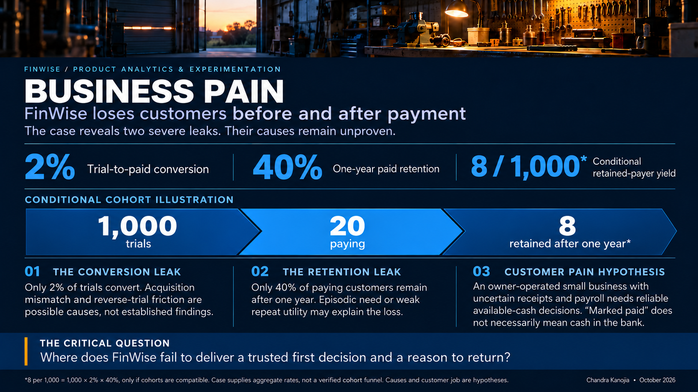
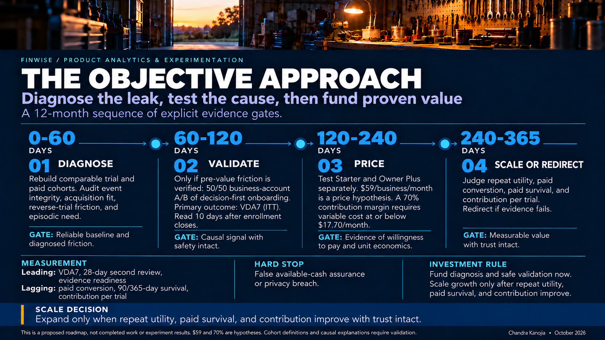
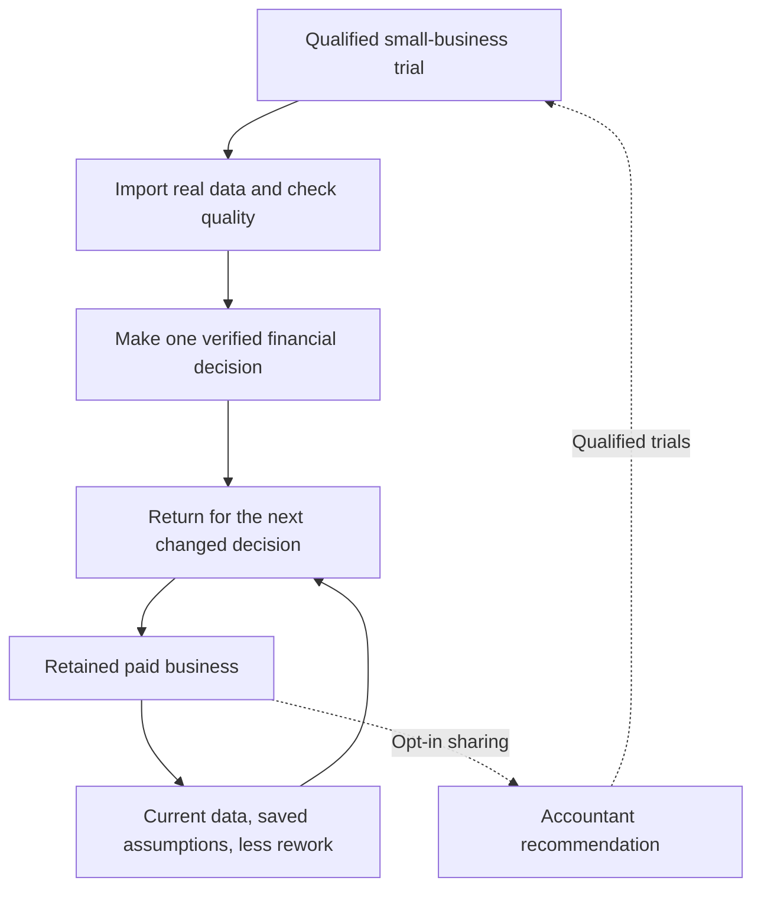

# The Bet | FinWise

### Visual overview of the commercial challenge and evidence-gated approach

[See the full 11-slide visual narrative](../visual-story/README.md).

> **Module 1: Ignite a Product-Led Growth Motion**  
> **Decision:** Prioritize learning how trials reach repeatable financial value before increasing paid acquisition. This is a strategic hypothesis to test, not a proven root cause.

## 1. Growth hypothesis

**If FinWise helps a qualified small-business owner turn their own financial data into one trustworthy, actionable decision early in the reverse trial, and makes the next decision easier, then more users should become paying customers and stay.** The proposed mechanism is value experienced before the payment decision, followed by a recurring job worth paying for.

The bet is **the first trusted financial decision**, not a faster signup, completed checklist, feature click, or attractive dashboard.

### What the case establishes

- **2% trial-to-paid conversion.** A trial is not reliably translating into willingness to pay.
- **40% one-year paid customer retention.** Even customers who pay are not consistently staying.
- **Marketing remains dependent on paid trial acquisition.** More signups currently feed a leaky system.

For perspective, a hypothetical 1,000-trial cohort would produce 20 paid customers, of whom eight would remain after one year **if** the stated conversion and retention rates applied to the same cohort. This is an illustration of the compounding loss, not observed cohort data or a revenue forecast.

These are **symptoms, not diagnoses**. The case gives no channel mix, trial duration, reverse-trial entitlements, price, acquisition cost, segment, time-to-value, churn timing, or user-level outcomes. The next analysis must test which part of the system is actually binding.

### Competing explanations and what would overturn the bet

| Hypothesis | Evidence that would favor it | Implication |
| --- | --- | --- |
| **H1: Value is reached too late or never repeated** (our first learning bet) | Large drop-off before users complete a useful financial decision; qualified users who do so later show stronger conversion and retained usage | Improve the first decision and repeat workflow; experimentally test causality |
| **H2: Acquisition brings the wrong customers** | Paid-ad cohorts show much lower activation, conversion, and retention than comparable organic or referred cohorts | Fix targeting and channel allocation before redesigning onboarding |
| **H3: The reverse-trial/paywall transition is mismatched to value** | Customers achieve and repeat value but do not pay when premium features expire | Investigate entitlements, timing, willingness to pay, and packaging |
| **H4: The job is episodic, not recurring** | Customers complete useful models but have little reason to return after the first answer | Reconsider target segment, recurring job, or business model before adding reminders |

**Why start with H1?** It creates the fastest testable bridge between acquisition and durable value, affects both conversion and retention if true, and can be investigated through existing import and modeling signals noted in the course templates. That is a **priority for learning**, not a claim that H1 is the most likely cause. If the evidence favors H2, H3, or H4, change course.

## 2. The bet

**Initial customer wedge (assumption to validate):** An owner-operated small business with variable cash timing and no dedicated finance team. Do not mix this user with accountants or larger finance departments in one undifferentiated activation rate. Their jobs, trust thresholds, and usage cadence differ.

**Job to be done:** *“If two customers pay late, can I still meet payroll and upcoming bills, and what should I change now?”*

**First-value design:** Import relevant business data, reveal freshness and unresolved exceptions, model one near-term cash scenario, then identify and save one decision. A customer should be able to explain the result and its assumptions. If FinWise does not support a step, adapt the implementation rather than pretend it exists.

**Repeat-value design:** When transactions, obligations, or assumptions change, the owner reviews an updated scenario without starting from scratch. Corrections and saved assumptions should reduce the work required for the next review. Repeated value is measured at the cadence of financial decisions, not by forcing daily logins.

**Scope of the first investment:** Instrument the journey and remove the largest verified obstacle between relevant data and first decision. Establish the second-use behavior before funding referrals or broad feature expansion. Inspect the actual premium-to-free transition separately, because a reverse trial can fail at the point where entitlements change even when onboarding succeeds.

**Not doing:**

1. **No incremental paid-acquisition scale** until downstream cohort economics warrant it. Do not confuse more trials with healthier growth.
2. **No discount-first conversion tactic** until we distinguish missing value from willingness-to-pay or packaging friction.
3. **No gamified engagement or automatic social sharing.** A finance product earns return usage through trustworthy decisions. Financial data and accountant invitations require explicit customer permission.

### Economics and decision measures

The outcome to improve is **retained paying businesses**, not trial starts. For a common observation window:

`Retained paid businesses = trial starts × trial-to-paid conversion × paid retention`

This simplified model does not yet include acquisition cost, ARPA, gross margin, expansion, or reactivation. Those inputs are required before a revenue or payback forecast. For example, 3% conversion and 60% annual retention would yield 18 retained payers per 1,000 trials, versus eight under the starting rates. **Both improvements are illustrative scenarios, not targets or predictions.**

| Signal | Operational definition | Why it matters |
| --- | --- | --- |
| **Candidate activation** | Share of eligible new businesses that use real data to complete and save a valid financial decision within seven days | Tests progress toward customer value, not mere setup |
| **Repeat value** | Share of activated businesses making a second meaningful review within 28 days | Tests whether there is a recurring job |
| **Commercial validation** | Trial-to-paid conversion, 90-day paid retention, and 12-month paid logo retention by cohort and source | Checks whether behavior translates into durable economics |
| **Guardrails** | Data accuracy, unresolved import/model exceptions, privacy consent, and support effort per activation | Prevents faster but less trustworthy activation |

The 2% baseline also affects testing feasibility. At 5% two-sided significance and 80% power, detecting a 20% relative lift from 2.0% to 2.4% requires roughly 21,100 trials per arm under conventional assumptions. We must check available traffic before promising a rapid conversion A/B test. Earlier activation outcomes can accelerate learning, but **cannot substitute for paid and retained outcomes**.

## 3. Growth loop

**Primary loop:** Better data-to-decision workflow → easier repeat financial review → more retained paid users → richer, current business context → more useful next decision.

**Conditional distribution loop:** Only after repeat value is demonstrated, a permissioned accountant collaboration flow may create recommendations to other businesses. This is a hypothesis, not built-in virality. At the case's 2% paid conversion, even two incremental trials per retained customer would yield only 0.04 expected new payers if referred trials convert at the same rate. Accountant-mediated distribution must prove a materially different reach, conversion, and cost profile.

The **solid loop** represents retained utility, not automatic user acquisition. The **dotted loop** is the distribution mechanism to investigate only when collaboration is genuinely valuable. Track invitations, acceptance, qualified trials, activation, paid conversion, and time from referral to purchase before claiming it compounds.

## 4. Decision rules and what we learn next

1. **Map the observed journey:** Trial source → first real import → completed model → decision achieved → second use → payment → retention. Verify event definitions, eligible denominators, and cohort maturity.
2. **Control the obvious confounders:** Compare segments and channels before claiming import/model behavior causes conversion. High-intent users may both use more features and pay more.
3. **Fund evidence, not conviction:** Proceed with the activation intervention only if there is a material, reachable pre-value loss and a feasible test that preserves financial trust. If users consistently experience value but decline to pay, shift the bet to entitlements and pricing. If paying customers achieve value once and leave, revisit the recurring job and target market.

**Current evidence status:** The brief supplies the three aggregate case facts above; the uploaded Markdown files are mostly deliverable templates, with one populated engagement scorecard. They do not include trial-level event data. Module 1 therefore ends with a *falsifiable investment hypothesis*, as the assignment asks, rather than presenting invented observations as findings. The hypothesis must be revised if later course data contradict it.
