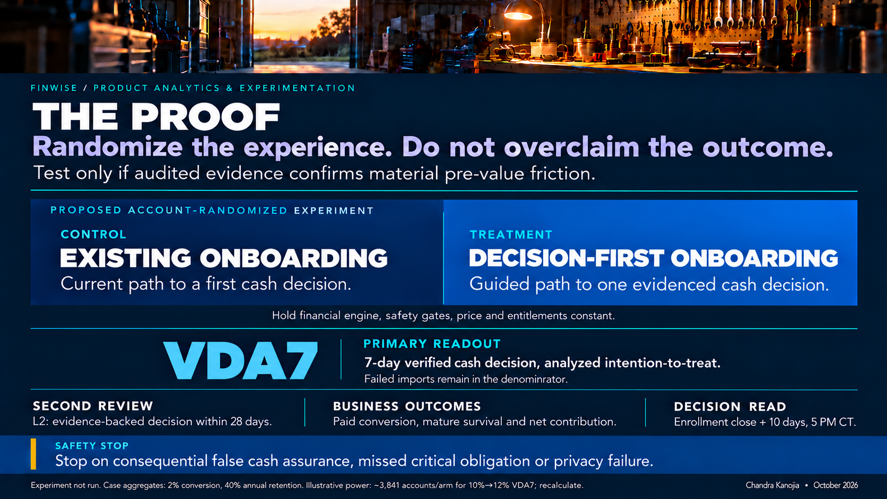
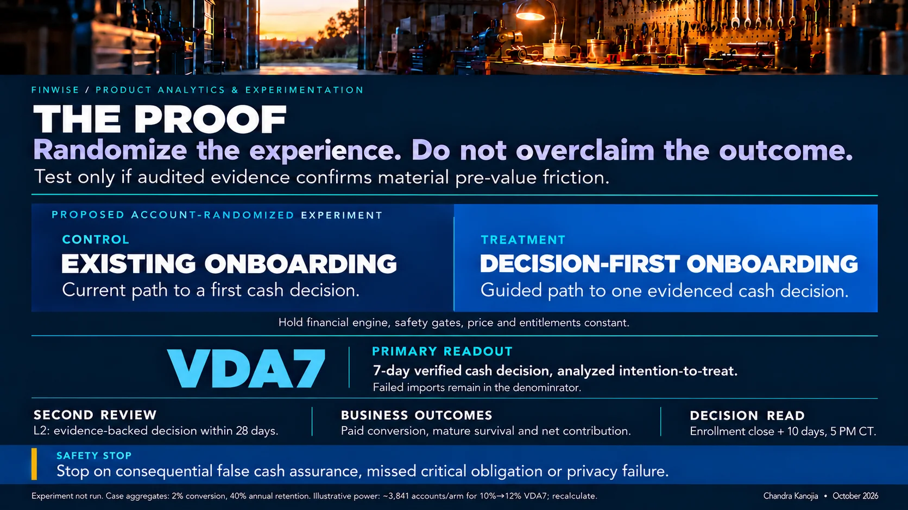

# The Validation | FinWise

### Visual: the proof must come from a guarded experiment

[See the complete slide sequence](../visual-story/README.md).

> **Module 5: Experimentation Methods**  
> **Decision to test:** Does a **decision-first onboarding flow** cause more qualified SMB trials to reach a *trustworthy first financial decision*?  
> **Method:** Business-account randomized controlled experiment, 50/50, with a fixed-horizon primary read.  
> **Status:** **Pre-registration proposal, not an experiment run or approved for production.** No actual FinWise traffic, activation baseline, trial length, incremental lift or test result has been supplied.

**Executive visual:** A gated and randomized test of decision-first onboarding, conditional on diagnosing pre-value friction.

## 1. Why this is the experiment worth considering

FinWise converts **2%** of trials to paid and retains **40%** of paying customers after a year. Those are business symptoms, not proof of onboarding failure. Modules 1–4 deliberately separated four competing causes: acquisition fit, difficulty reaching value, reverse-trial packaging, and a job too episodic to justify continued payment.

**Experimentation gate:** Run this test **only if** the audited account-level funnel and owner interviews show material, fixable loss *before a verified first financial decision*. If customers already reach and repeat meaningful value but decline to pay at downgrade, the higher-value experiment belongs at the entitlement/pricing boundary instead. If the primary loss is unavailable or unreliable financial data, solve that source/operating problem before testing the interface.

**The decision is narrower than the strategy:** Test the *path to the first decision*, not Module 3's Decision Delta or a new pricing offer at the same time. Changing all three would obscure causality.

## 2. Method and treatment contract

**Method:** A/B test with random assignment **before onboarding exposure**, persisted at the business-account level. One business remains in its assigned experience across devices, users and sessions. Where one owner controls multiple businesses, cluster assignment by owner to prevent cross-business contamination, while reporting the business-level outcome with clustering-aware uncertainty.

| Design element | Control A: current experience | Treatment B: decision-first experience |
| --- | --- | --- |
| **Entry** | Existing FinWise trial onboarding, documented and snapshotted before launch; actual sequence **unknown until audited**. | Ask the owner which imminent financial decision matters, starting with *“Can I meet payroll and bills if customers pay late?”* |
| **Data step** | Existing, same permission and evidence safeguards. | Contextual import for the chosen question; visibly surface source freshness, reconciled **available** cash, future uncertain receipts and missing critical obligations. |
| **First outcome** | Whatever scenario/decision affordances currently exist, measured using **the same** verified-decision definition. | Review the 14-day risk scenario, see first potential floor breach, inspect assumptions and save a disposition/next check. Module 2 is a **prototype**, not an existing deployed feature. |
| **Held constant** | Same forecasting logic, data-quality and risk gates, permissions, premium entitlements, pricing, offers, acquisition campaigns and support eligibility in both arms. | Same underlying engine and controls. No improved financial answer, auto-transfer, credit recommendation or special discount is bundled with the treatment. |

**Population:** New, first-time trials from the proposed owner-operated SMB cash-timing segment, where account role and supported integration eligibility can be defined **before** assignment. Freeze eligibility rules and channel/connector strata in a versioned specification. Do **not** condition the denominator on a successful import, clicking a scenario or staying for seven days. Exclude demo/test accounts using predeclared rules, not their later behavior. Analyze all assigned eligible businesses under **intention to treat (ITT)**, even when onboarding fails or the user declines access.

**Rollout discipline:** Establish event validity and a safe baseline in an internal/synthetic environment, obtain data-risk/product/engineering sign-off, then use a limited production ramp to check assignment integrity and incident response. Never represent the HTML walkthrough as tested banking software. Suspend ramp on safety failures; do not read an early efficacy winner from operational smoke-test traffic.

## 3. Hypothesis, primary metric and estimand

> **Hypothesis:** Among pre-eligible SMB trial businesses, a decision-first journey that makes source limitations explicit will improve **seven-day verified activation** relative to the unchanged onboarding experience, without increasing misleading cash assurance, critical missing-obligation decisions, privacy incidents or untenable support effort.

**Primary metric:** `VDA7 = unique eligible randomized businesses saving ≥1 valid real-data financial decision within seven days of trial start / all eligible randomized business trial starts`.

A *valid decision* requires **all** of these conditions:

1. Authorized business data, a source/assumption version, usable opening cash evidence and critical dated obligations; uncertainties and unreconciled items are explicit, not silently treated as available funds.
2. A modeled cash-risk question with relevant timing and the user's floor, plus an evidence-inspection/assumption acknowledgement.
3. An actual customer disposition (keep, revise, escalate or deliberate no action), reason or next check recorded. A view, click, fabricated demonstration or failed import is **not** activation.
4. No unresolved *critical* evidence failure that would make the answer misleading. A scenario **may** show uncertain future receivables; they must remain assumptions rather than confirmed deposits. Independent blinded sampling audits event validity across arms.

**Estimand:** `VDA7(B) − VDA7(A)` in **percentage points** for all eligible randomized businesses (ITT). Report the relative change as secondary context, with group counts and a two-sided 95% confidence interval. The analysis unit is the business; account ownership clustering and predeclared assignment strata must be respected. Do not silently change the primary metric to completion rate among importers.

**Design target for power planning:** Candidate **20% relative increase** in VDA7, **not** an observed effect or management commitment. The actual minimum worthwhile effect must be locked before assignment using audited baseline VDA7, incremental delivery/support costs and the required path to durable paid economics. If the reverse trial is shorter than seven days, **do not launch under this definition**: choose and register a primary window that precedes its entitlement transition.

## 4. Guardrails: the customer can act on the answer

| Guardrail / ownership | Non-negotiable decision rule |
| --- | --- |
| **Critical false “all clear,” payment/permission incident** (finance-domain/risk owner) | **Zero accepted severe incidents.** Any confirmed case of the experience representing held, uncleared or missing funds as safely available for a critical payment, or an unauthorized exposure/action, **pauses the affected experience immediately**, regardless of activation lift. Incident review and remediation are required before restarting. |
| **Correctness and obligation coverage** (data/finance-domain owner) | Same verified-decision acceptance criteria in both arms. Report missing payroll taxes, ACH cutoff uncertainties, duplicates, reconciliation exceptions and decision corrections per attempted/accepted decision. No relaxation of evidence thresholds to improve the numerator. |
| **Consent and operational burden** (privacy/support owner) | No new financial access without consent; no raw bank or payroll details in general analytics or notifications. Track opt-outs, import failures, p90 support minutes per eligible business, support cases and connector costs. Pre-register acceptable non-inferiority margins from actual baseline/SLO and account economics **before exposure**; none are given by the case. |
| **Experiment integrity** (analytics/engineering owner) | Check randomization balance and sample-ratio mismatch, assignment persistence, telemetry loss, event duplicates, cross-business contamination and concurrent changes to offers/entitlements. If a material integrity issue occurs, halt the efficacy read until resolved. |

Both arms remain **read-only decision support**. No automated borrowing, customer contact, payroll deferral, payment instruction or release of an existing liquidity plan. The owner must verify the actual bank/payroll processing deadline and retains final authority. A faster but less trustworthy decision is an **experiment failure**, not a metric trade-off.

## 5. Sample size, timeline and read date

The case gives **2% paid conversion**, **not** VDA7. Using 2% as the activation baseline would be statistically indefensible. Under a conventional **two-sided 5% significance, 80% power**, independent equal arms and no attrition, illustrative sample requirements for a *20% relative activation lift* are:

| Hypothetical control VDA7 | Candidate treatment VDA7 | Approximate businesses **per arm** | Total, before cluster/design and data-quality adjustments |
| ---: | ---: | ---: | ---: |
| **10%** | **12%** | **3,841** | **7,682** |
| **15%** | **18%** | **2,402** | **4,804** |

**These are planning scenarios, not FinWise observations.** Recalculate after discovering true baseline VDA7, eligible weekly traffic, owner-level clustering/design effect, expected telemetry loss, segment mix and economic minimum effect. If required enrollment takes an unreasonable fraction of the product roadmap, **do not promise a rapid powered A/B test**: use a smaller, explicitly directional usability/operational diagnostic first, narrow the intervention or redirect the question. At 2% paid conversion, a 2.0%-to-2.4% lift requires roughly **21,100 trials per arm** under the same unadjusted assumptions; commercial outcomes will often need a longer follow-up.

**Read date (fixed relative protocol):**

1. **Before first assignment (T0):** Product, analytics, finance-domain risk and engineering approve a versioned protocol, baseline/MDE/power calculation, enrollment cap, maximum recruitment window, event audit and guardrail thresholds. No unapproved midtest changes.
2. **Enrollment closes at T_close:** The **pre-registered** sample target is reached, or the predetermined maximum enrollment date is reached. Under-enrollment is reported as inconclusive, not silently extended in response to effect direction.
3. **Primary efficacy read: T_close + 10 calendar days, 5:00 p.m. CT.** Every enrolled account has a full seven-day primary window plus up to three days for late-arriving event reconciliation and frozen-data QA. No repeated significance peeking or early winner announcement. **Daily safety and instrumentation monitoring are allowed**; they are not efficacy decisions.
4. **Secondary reads:** 28-day verified second review only when every included cohort has matured; trial-to-paid when each offer's defined conversion window has matured; then 90-day and 365-day paid-retention follow-up. Do not use a day-28 event to “explain” an earlier payment or claim annual retention from immature accounts.

A calendar date is **intentionally not fabricated**: FinWise's launch, traffic and reverse-trial length are absent from the supplied materials. The relative read date above is operationally binding once T_close is fixed; the corresponding calendar date must be published **before** enrollment.

## 6. Interpretation: decide, do not decorate a dashboard

| Finding at the preregistered read | Product decision |
| --- | --- |
| **VDA7 point lift meets the pre-agreed useful effect, 95% interval excludes zero, all trust/operating guardrails pass, and follow-up looks directionally healthy** | **Conditional expansion.** Validate additional segments and later paid conversion; no claim of solved retention until mature revenue cohorts confirm. |
| **VDA7 rises but confirmed accuracy, material obligation coverage, privacy or support economics worsen** | **Do not ship.** Restore the safe state and correct the failure even if activation looks excellent. |
| **VDA7 improves but later paid conversion deteriorates or few activated accounts make a second meaningful review** | **Do not scale as a growth win.** Examine whether the Aha is valuable enough to pay for and repeat; pivot to entitlement or recurring-job validation. |
| **No credible useful lift, or underpowered/unreliable data** | **Reject the claim, not the users.** Review the step-funnel, interview accounts and, if warranted, redesign. Do not post hoc choose a winning subgroup or redefine success. |
| **Diagnostic evidence instead points to channel mismatch or reverse-trial downgrade** | **Cancel/replace this experiment before launch** with the test aligned to the actual bottleneck. Owning a prototype is not a reason to fund it. |

**What Module 5 validates:** A causal test of the *first trusted decision*, conditional on observable pre-value friction. **What it does not validate:** that Decision Delta causes year-one retention, that the 2% conversion baseline will rise, that the mechanic creates profitable recurring demand, or that a safe accounting model is already live. Those claims require distinct evidence.

> **Executive rule:** In financial software, experiment velocity does not outrank the duty to give a defensible answer. A metric gain that makes a small-business owner more likely to make a bad cash decision is negative product value.

---

**Evidence boundary:** Proposal built from the Product School FinWise case and the artifacts in Modules 1–4. The supplied templates contain no account-level funnel dataset or treatment outcomes. All sample-size and outcome examples are explicitly hypothetical; no FinWise experiment has been run.
