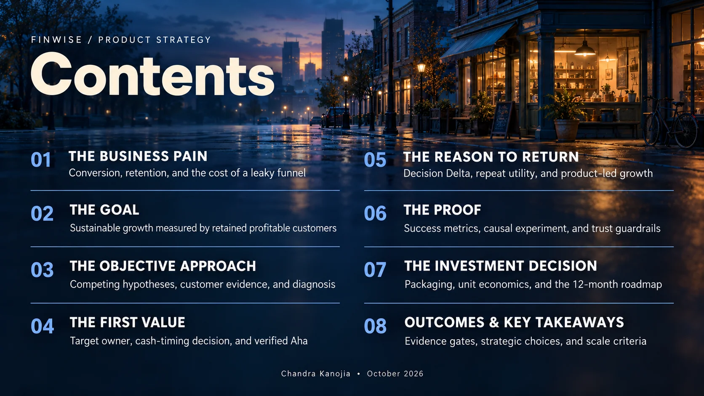
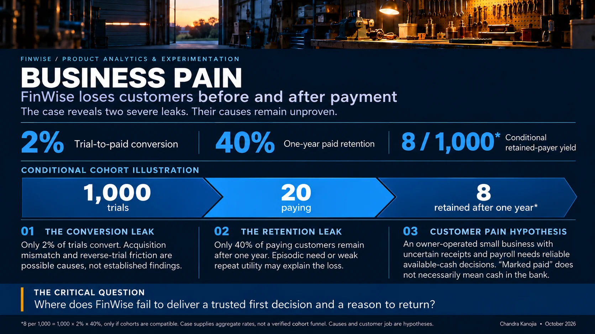
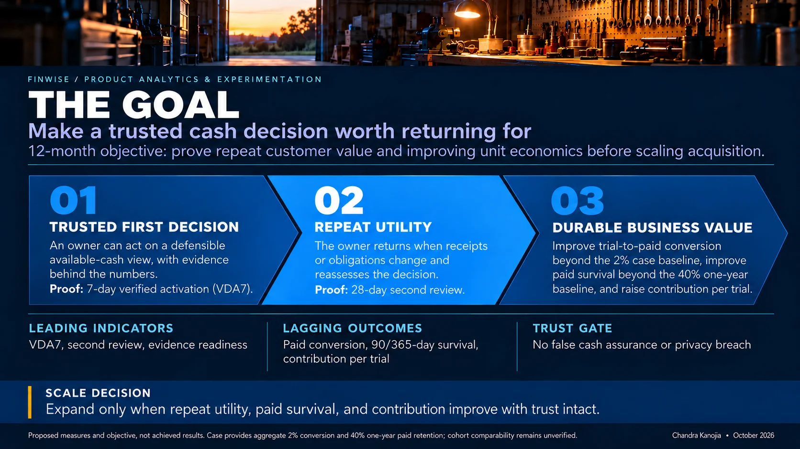
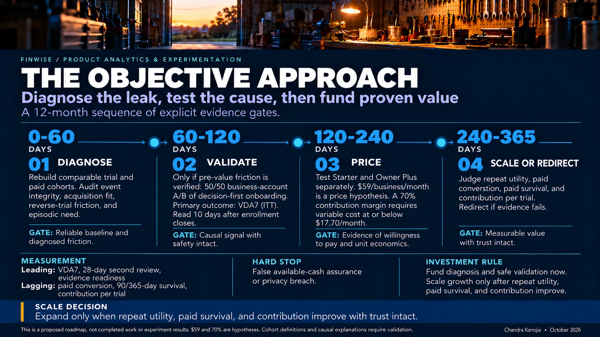
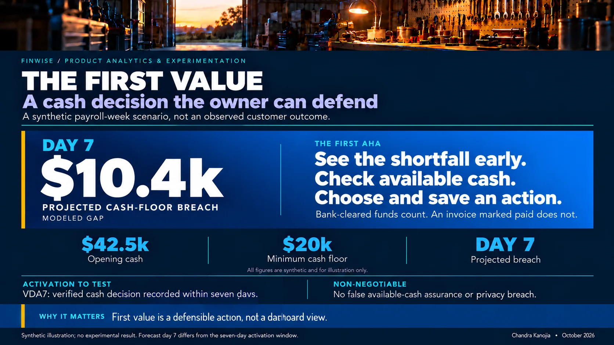
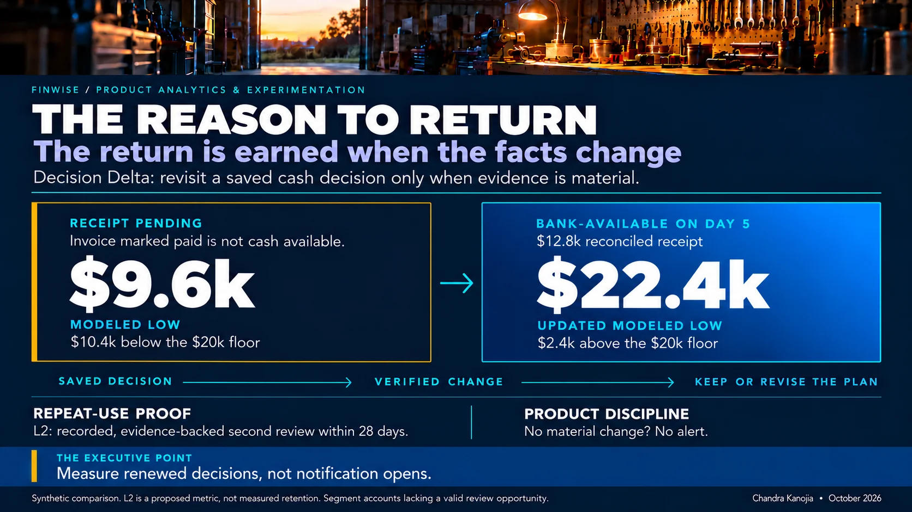
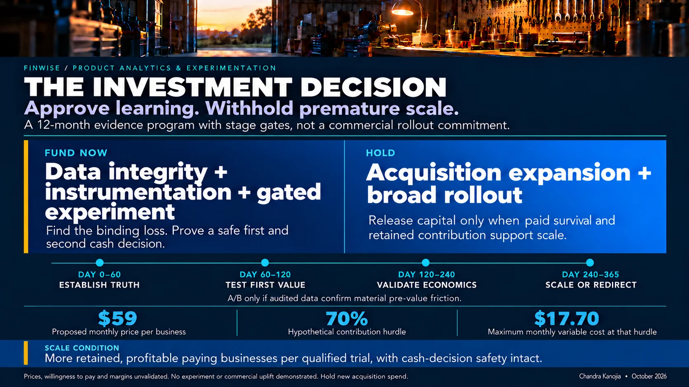
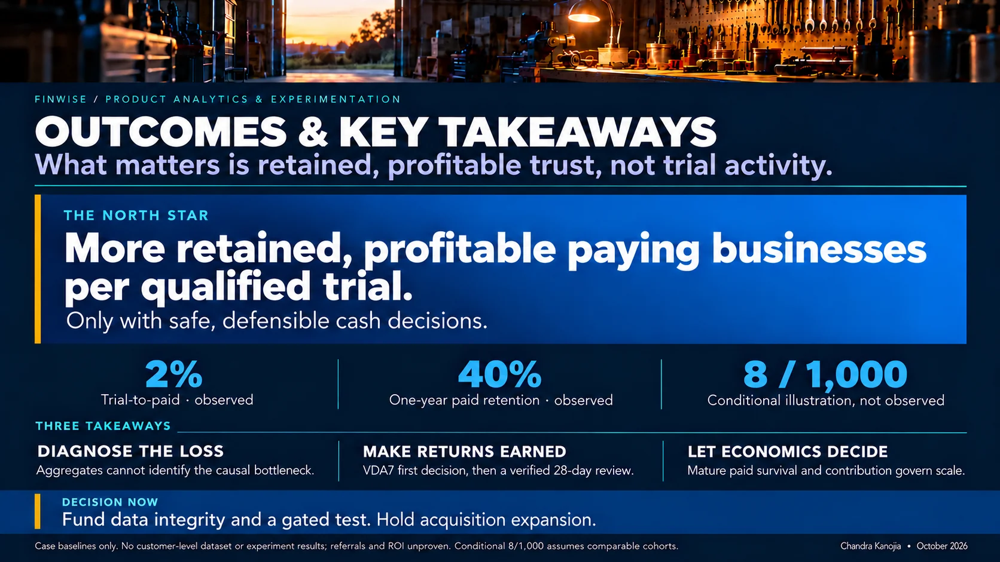
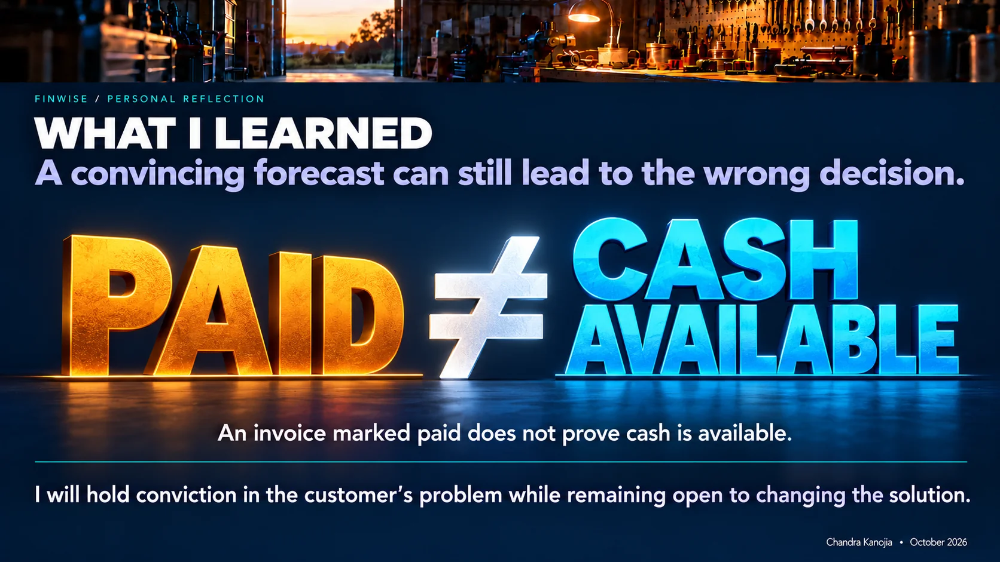

# FinWise | Selected executive slides

**Product Analytics & Experimentation · Final Project · October 2026**

These are the 11 approved slide images in presentation order. The original-resolution PNG files are available separately in the downloadable slide package. GitHub displays optimized WebP versions for faster loading; the strategic proposal, example numbers, and experiments remain clearly identified as case evidence, conditional arithmetic, or hypotheses.

[Back to the executive strategy](./README.md) · [Open the featured growth thesis](./assets/finwise-growth-thesis.webp) · [Open the interactive strategy pitch](./pitch.html)

## 01 · The Night Before Payroll

[Open image](./assets/slides/01_Cover_Night_Before_Payroll.webp)

## 02 · Contents

[Open image](./assets/slides/02_Contents.webp)

## 03 · The Business Pain

[Open image](./assets/slides/03_Business_Pain.webp)

## 04 · The Goal

[Open image](./assets/slides/04_The_Goal.webp)

## 05 · The Objective Approach

[Open image](./assets/slides/05_The_Objective_Approach.webp)

## 06 · The First Value

[Open image](./assets/slides/06_The_First_Value.webp)

## 07 · The Reason to Return

[Open image](./assets/slides/07_The_Reason_To_Return.webp)

## 08 · The Proof

[Open image](./assets/slides/08_The_Proof.webp)

## 09 · The Investment Decision

[Open image](./assets/slides/09_The_Investment_Decision.webp)

## 10 · Outcomes and Key Takeaways

[Open image](./assets/slides/10_Outcomes_And_Key_Takeaways.webp)

## 11 · What I Learned (Variation C)

[Open image](./assets/slides/11_Personal_Reflection_Variation_C.webp)

---

**Interpretation:** This is an investment thesis and design proposal, not an account-level customer analysis, a completed experiment, or a production rollout.
