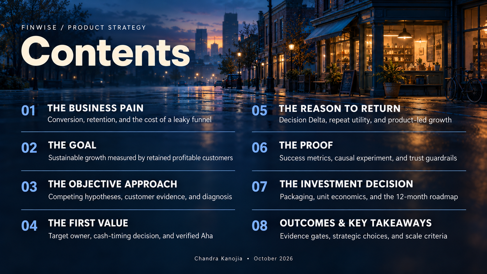
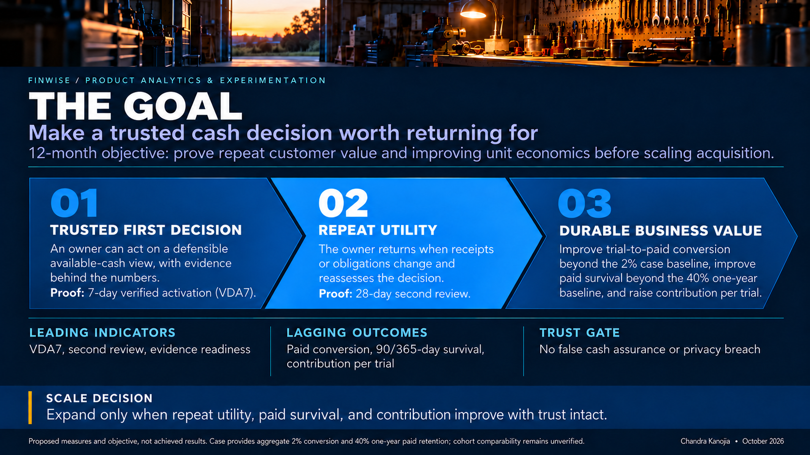
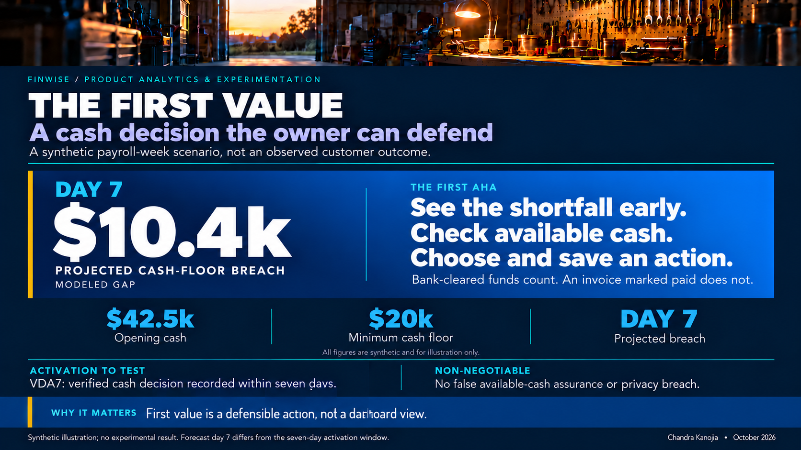
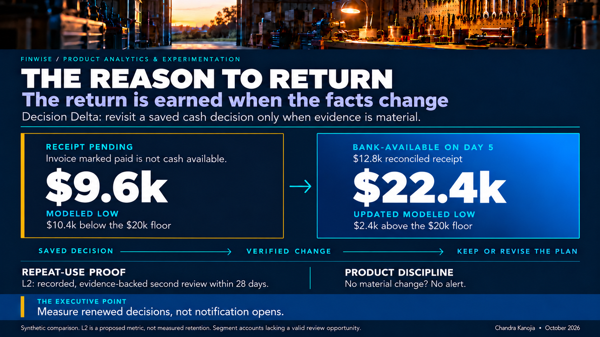
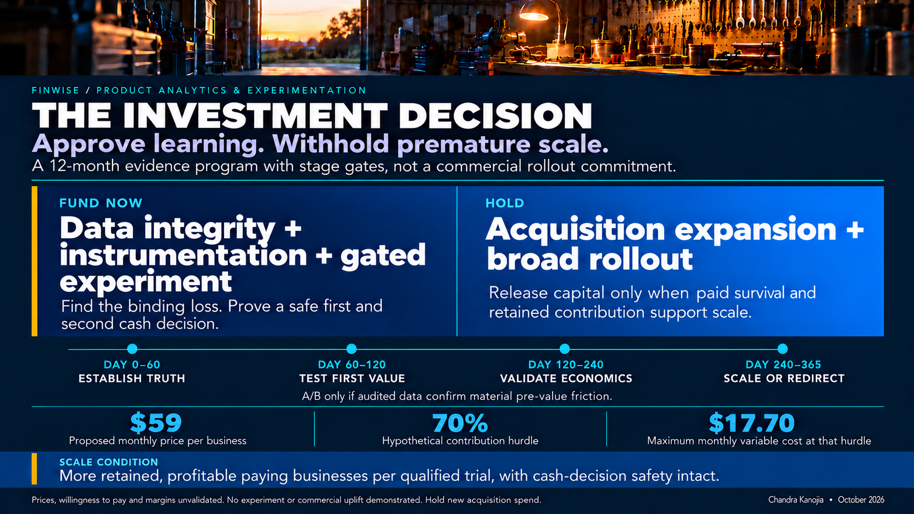
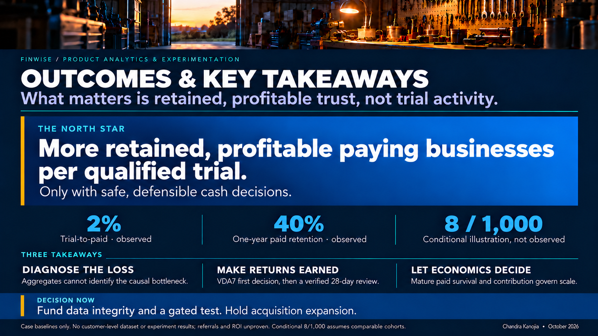
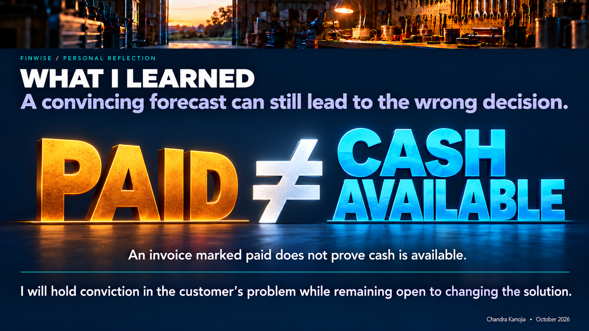

# FinWise | Executive visual narrative

**Product Analytics & Experimentation · Final project · October 2026**

Eleven approved full-resolution slide images, in presentation order. The original eight-section [`pitch.html`](../pitch.html) remains a separate, unchanged presentation.

These visuals are a **proposed strategy**, not evidence of executed experiments or observed customer outcomes. Synthetic financial scenarios and conditional arithmetic are labeled in the underlying module artifacts.

[**Open the visual slide presentation**](./index.html) · [**Read the six-module strategy**](../README.md)

## 01 | The Night Before Payroll

The first trustworthy financial decision. [Read the relevant evidence and judgment](../01-bet/growth-bet.md).

## 02 | Contents

Eight-part executive narrative. [Read the relevant evidence and judgment](../README.md).

## 03 | The Business Pain

Diagnose the trial-to-paid and retention leaks. [Read the relevant evidence and judgment](../01-bet/growth-bet.md).

## 04 | The Goal

Make a trusted cash decision worth returning for. [Read the relevant evidence and judgment](../01-bet/growth-bet.md).

## 05 | The Objective Approach

Four evidence gates for an investment decision. [Read the relevant evidence and judgment](../01-bet/growth-bet.md).

## 06 | The First Value

An evidence-bounded cash decision. [Read the relevant evidence and judgment](../02-solution/activation-solution.md).

## 07 | The Reason to Return

A Decision Delta from a verified change. [Read the relevant evidence and judgment](../03-mechanic/engagement-mechanic.md).

## 08 | The Proof

Randomized experiment, guardrails, no causal overclaim. [Read the relevant evidence and judgment](../05-validation/experiment-brief.md).

## 09 | The Investment Decision

Fund evidence first; scale only with defensible economics. [Read the relevant evidence and judgment](../06-model/pricing-model.md).

## 10 | Outcomes & Key Takeaways

Retained profitable payers over superficial engagement. [Read the relevant evidence and judgment](../README.md).

## 11 | What I Learned | Variation C

PAID ≠ CASH AVAILABLE. [Read the relevant evidence and judgment](../README.md).

---

**Evidence discipline:** Case-reported conversion and retention are not matched-cohort proof; $10,400 / $22,400 cash figures are synthetic; experiments, pricing, and adoption outcomes are hypotheses until validated.